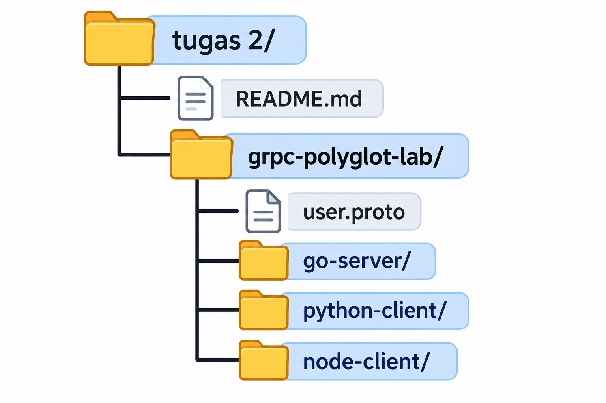

# Tugas 2 — Komunikasi Inter-service dengan gRPC (Polyglot)

## 1. Deskripsi

Praktikum ini membahas komunikasi antar-service menggunakan gRPC dengan bahasa Go, Python, dan Node.js. Go digunakan sebagai server, sedangkan Python dan Node.js digunakan sebagai client untuk meminta data pengguna.

## 2. Teknologi yang Digunakan

- Go sebagai server.
- Python sebagai client.
- Node.js sebagai client.
- gRPC untuk komunikasi antar-service.
- Protocol Buffers untuk mendefinisikan layanan.

## 3. Struktur Folder



## 4. Langkah Menjalankan Program

### A. Menjalankan Go Server

Buka terminal VS Code dan masuk ke folder `go-server`.

```powershell
go run main.go
```

Jika berhasil, akan muncul pesan:

```text
gRPC Server (Go) berjalan di port :50051...
```

Biarkan server tetap berjalan.

### B. Menjalankan Python Client

Buka terminal baru dan masuk ke folder `python-client`.

Instal library jika belum tersedia:

```powershell
python -m pip install grpcio grpcio-tools
```

Jalankan client:

```powershell
python client.py
```

### C. Menjalankan Node.js Client

Buka terminal baru dan masuk ke folder `node-client`.

Instal library jika belum tersedia:

```powershell
npm install @grpc/grpc-js @grpc/proto-loader
```

Jalankan client:

```powershell
node client.js
```

## 5. Hasil Pengujian

Jika client mengirim ID pengguna `1` dan program berjalan dengan benar, respons yang diharapkan adalah:

```text
Respon dari Server -> Nama: Budi Santoso, Email: budi@universitas.ac.id
```

## 6. Kesimpulan

Praktikum ini menunjukkan bahwa Go, Python, dan Node.js dapat berkomunikasi menggunakan gRPC. Go berperan sebagai server, sedangkan Python dan Node.js berperan sebagai client. Dengan demikian, beberapa bahasa pemrograman dapat digunakan bersama dalam satu sistem.

